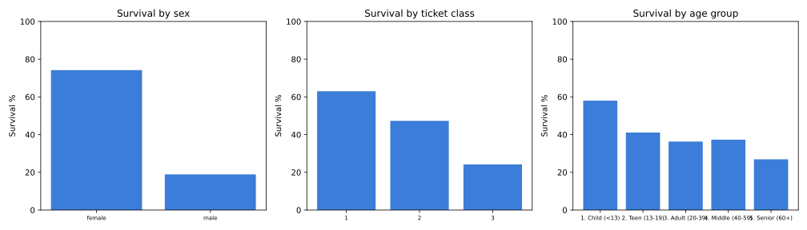

# Titanic Survival Analysis (Python + SQL)

Exploratory data analysis of the public Titanic passenger dataset (891 passengers) using pandas for cleaning and SQL (SQLite) for the analysis.

## Dataset
`data/titanic.csv` from the seaborn-data repository (https://github.com/mwaskom/seaborn-data), a public copy of the well-known Titanic dataset.

## What it does
1. Loads the CSV and counts missing values (age 177, embarked 2, deck 688).
2. Cleans: missing ages filled with the median age of the same class and sex; `deck` dropped (77% missing); 2 missing embarkation towns labelled "Unknown".
3. Loads the data into an in-memory SQLite table and runs 7 SQL queries (GROUP BY, CASE, aggregates).
4. Saves `report.txt` (all tables) and `survival_charts.svg` (PNG too when you run the script).

## Key findings (from `run_output.txt`)
- Overall survival: 342 of 891 (38.4%).
- Women survived at 74.2%, men at 18.9%.
- By class: 1st 63.0%, 2nd 47.3%, 3rd 24.2%.
- Children under 13 survived at 58.0%; seniors 60+ at 26.9% (only 26 people).
- Women in 1st class: 96.8%; men in 3rd class: 13.5%.
- Travelling alone: 30.4% survived; with family: 50.6%.

These are correlations in historical data, not causes.

## How to run
```bash
pip install -r requirements.txt
python analysis.py
```
Tested with Python 3, pandas 2.3.3, matplotlib 3.10.9.

## Chart

